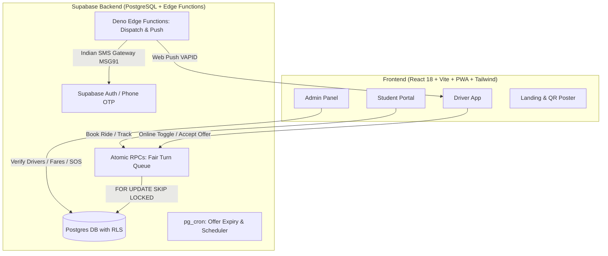

# 🛺 Ride Mitra (रिक्षा मित्र)
### Auto-Rickshaw Booking Portal for Lavel Stop ↔ Gharda Institute of Technology (GIT) & Hostel

**Ride Mitra** is an auto-rickshaw booking web application engineered for the fixed transit corridor between **Lavel Stop (Highway/Bazaar/ST Stand)** and **Gharda Institute of Technology (GIT) Campus & Hostel**.

---

## 🏗️ Architecture



---

## 🚀 Key Features

1. **Student Booking:** Fixed stops, upfront fare matrix (zero bargaining), private full auto or per-seat shared rides, live tracking, driver profile & phone call, safety SOS.
2. **Driver App (0% Commission):** Marathi-first interface, 48px+ touch targets, big Online/Offline switch, Fair Turn rotation queue position, loud Web Audio chime for incoming requests, 30s countdown timer, Google Maps deep link navigation, earnings tracker.
3. **Admin Portal:** Driver verification queue (approve/reject/suspend), Stop and Fare management, complaint resolution, live high-priority emergency SOS list, Recharts analytics, and CSV export.
4. **Offline PWA:** Installable on low-end Android smartphones with service workers and local caching.

---

## ⚡ Quick Start (Under 2 Minutes)

```bash
# 1. Clone repository
git clone https://github.com/your-username/ride-mitra.git
cd ride-mitra

# 2. Install dependencies
npm install

# 3. Start local development server
npm run dev
```

The app will launch at `http://localhost:5173/` in **Demo Mode**, pre-seeded with Lavel corridor stops, fare matrix, test drivers, and admin credentials.

---

## 🔐 Authentication & Demo Switcher

The application includes an instant **1-Click Demo Switcher** banner on `/login` to test all roles without needing live SMS telecom credentials:
- **🎓 Student:** Rahul Patil (`9123456789`, OTP: `123456`)
- **🛺 Driver 1:** Santosh Tambade (`9822114455`, OTP: `123456`, Plate: `MH 08 AG 4521`)
- **🛺 Driver 2:** Sanjay Kadam (`9822667788`, OTP: `123456`, Plate: `MH 08 BF 1289`)
- **🛡️ Admin:** Prof. Joshi Sir (`admin@git.edu`, Password: `admin123`)

---

## ⚙️ Environment Variables

Create `.env` using `.env.example`:

```env
# Supabase Cloud Configuration
VITE_SUPABASE_URL=https://your-project.supabase.co
VITE_SUPABASE_ANON_KEY=eyJhbGciOi...

# Set to 'false' in production with live Supabase database
VITE_DEMO_MODE=true

# Web Push VAPID Public Key
VITE_VAPID_PUBLIC_KEY=your-vapid-public-key

# Feature Flags
VITE_FEATURE_PAYMENTS=false
VITE_FEATURE_PASSES=false
```

---

## 📲 Indian SMS Gateway Configuration (MSG91 / Twilio)

In Supabase cloud, configure the Auth SMS Hook pointing to `supabase/functions/otp-hook`:

```bash
supabase secrets set SMS_PROVIDER="msg91"
supabase secrets set MSG91_AUTH_KEY="your-msg91-auth-key"
supabase secrets set MSG91_TEMPLATE_ID="your-dlt-template-id"
```

---

## 🧪 Testing

```bash
# Run Vitest test suite
npm run test

# Run Vitest in watch mode
npm run test:watch

# Production build test
npm run build
```

---

## 🚢 Deployment

### Deploying Frontend (Vercel / Netlify)
1. Push repository to GitHub.
2. Import project in Vercel or Netlify.
3. Build command: `npm run build`, Output directory: `dist`.
4. Add environment variables from `.env.example`.

### Deploying Backend (Supabase Cloud)
```bash
# Link to your Supabase project
supabase link --project-ref your-project-ref

# Apply database migrations
supabase db push

# Deploy edge functions
supabase functions deploy dispatch-ride
supabase functions deploy send-push
supabase functions deploy expire-offers
supabase functions deploy sos-notify
```

---

## 📂 Documentation

- [Database ER Diagram](docs/ER_DIAGRAM.md)
- [API and RPC Reference](docs/API_RPC_REFERENCE.md)
- [वापरकर्ता मार्गदर्शिका (Marathi Guide)](docs/USER_GUIDE_MR.md)
- [User Guide (English)](docs/USER_GUIDE_EN.md)
- [Final Year Presentation Demo Script](docs/DEMO_SCRIPT.md)
